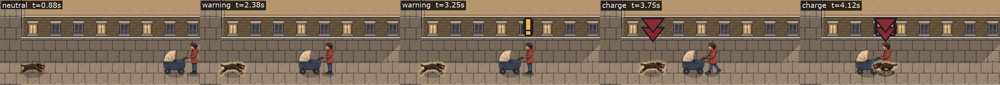
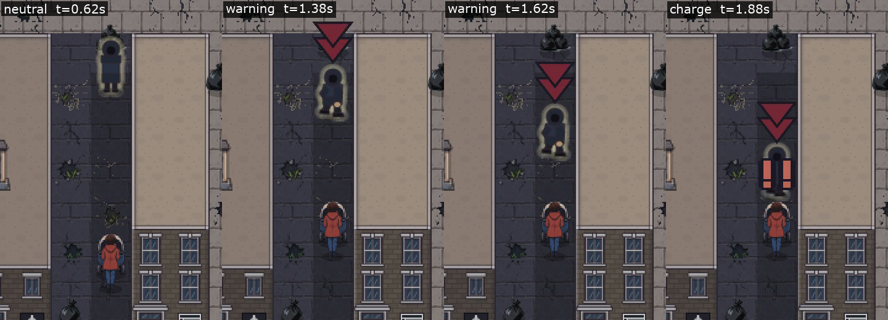
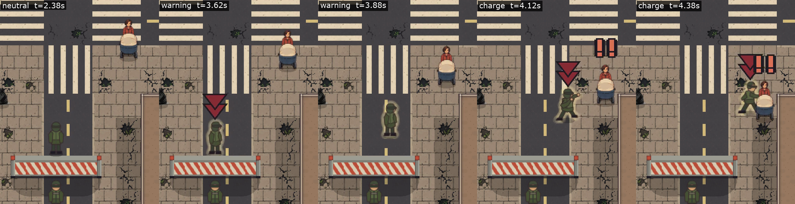
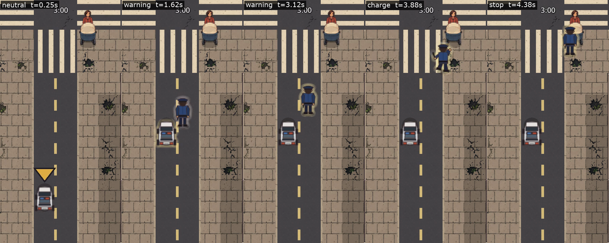
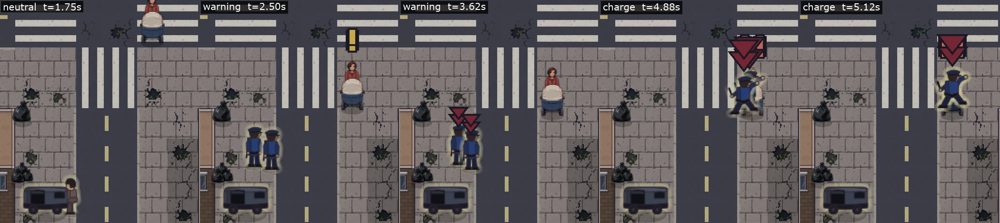
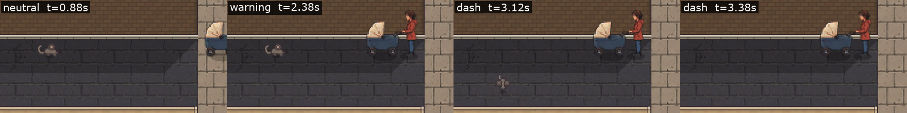
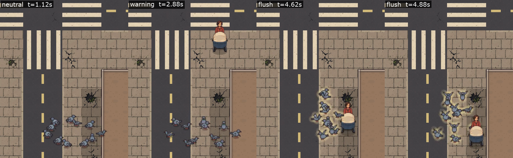

# teal-trout — every charger's three stages, audited (2026-10-11)

**The claim.** The table below lists every entity that waits and then comes at her, with what it
draws while neutral, what changes when she comes close, and what it draws while charging, and the
code that picks each picture. Each row is backed by one frame-locked clip of that charger going
through its stages, from a scene recipe that stands her in front of it, and a strip of its key
frames. It is the evidence for [teal-trout](../../todo/2026-10-11-teal-trout/README.md)'s first
item, *every charger's three stages are listed*, and for the player's choice of what the warning
stage looks like; it proposes no drawing.

**Scope**, from [velvet-marten](../../playtests/2026-10-11-velvet-marten.md): #699 asks for
"neutral (with neutral visuals), warning (when the player gets close; needs to be visually
distinct), and then the actual charging"; #704 puts the police and guards who notice and lunge in
("yes, why wouldn't they?"); #705 leaves out a pursuer that arrives already charging ("how would
that make sense?"). The three rows the queue entry names as places to start looking that turn out
not to charge her (the alley mouse, the pigeon flock and the masked man on the stairs) are listed
after the table, as are the pursuers left out by #705.

## How to read the stages

- **Neutral** is the event before it has noticed her: `EventInstance.is_waiting()`
  (`src/events/event_instance.gd:3858`, true while a row with a trigger distance,
  `pursues_within`, has not noticed her yet).
- **Warning** is from the notice until it actually comes for her: `is_telegraphing()`
  (`event_instance.gd:3848`, false while waiting, false once it has lunged, otherwise true until
  `telegraph_time` has run). A pursuer spends it closing to its stand-off and holding it; it
  lunges early the moment the gap is down to its stand-off, whoever closed it
  (`_chase()`, `event_instance.gd:2372`).
- **Charge** is the lunge and the chase after it.

The cues every row shares are not part of its picture but sit on top of it, and they change with
the stage too: the caret over the thing (`_draw_mark()`, `event_instance.gd:5004`) **flashes for
the whole warning** (`event_instance.gd:5011`) and is steady while charging; it is never doubled
red while waiting, because `will_be_lethal()` refuses a waiting row (`event_instance.gd:4458`). The
exclamation mark over her goes up for a `hard_fail` row closing on her. Those are the existing
vocabulary (the **cues** skill), so the warning stage's own picture is what the table is about.

## The table

| Charger | Row or class | Neutral (waiting) | When she comes close (warning) | Charging | Short of |
|---|---|---|---|---|---|
| **Charging dog**, from day 4, placed on the map | `charging_dog` (`src/events/event_catalogue.gd:1538`; trigger 130px from day 4, `:1576`) | Its running picture, `CHARGING_DOG_BY_VIEW` frame a, held still (`event_instance.gd:5341`; frame b only while it covers ground, `_gait_stepping()`, `:4714`): legs stretched mid-gallop, the "looks like it's flying" of #698 | **The same picture.** It turns to face her (`event_instance.gd:2398`, in `_chase()`'s notice) and closes to its 104px stand-off at a gallop (frames a and b by distance walked, `event_instance.gd:5341`), then holds it standing still on frame a. **No caret over the dog while it holds** (seen in the clip): held still, neither its doubled red caret (its own course reaching her) nor its amber one (what it is projected to net her) comes up, so only the amber exclamation mark over her says anything | The same picture, galloping (a and b), with the doubled red caret | **Neutral and warning both.** All three stages are one picture; the wait is a gallop frozen in the air, and the warning is only the dog turning and the mark over her |
| **Alley robber**, and the resistance's guards who are the same row | `alley_robbery` (`event_catalogue.gd:1980`, trigger 140px `:2022`); the chalk mark's guard and day 13's roadblock-task guard are `alley_robbery` instances (`src/resistance/resistance_director.gd:753`, set on her by `notice_her_at()` at `:2928`) | `ROBBER_WAITING_BY_VIEW`, hood up and hands in his coat, turned toward her along a clear line (`event_instance.gd:5674`–`5675`, `_robber_waiting_heading()` `:5719`) | `ROBBER_LUNGING_BY_VIEW`, leaning over a forward leg, from the frame he notices her (`event_instance.gd:5675`); he closes to his 116px stand-off with the lunge's stride frames; flashing doubled red caret | `ROBBER_LUNGING_BY_VIEW` and its stride `_B` (`event_instance.gd:5678`–`5679`), steady caret | **Warning reads as the charge.** Neutral is distinct; the warning is already the lunge picture, told from the chase only by the caret flashing. Standing at his edge, the warning lasted about 0.6s in the clip |
| **Hunting roadblock's guard** (heat 4) | `roadblock` at `HeatResponse.HUNTS` (`event_catalogue.gd:1878`; `EventDef.at_heat()` sets the 180px trigger, `src/events/event_def.gd:1145`) | Two guards posted at the band, `GUARD_STANDING_BY_VIEW`, facing out from it (`_draw_posted_guard()`, `event_instance.gd:5845`) | The guard on her side becomes the chaser at his own post (`_set_off_from_the_near_post()`, `event_instance.gd:1580`) and is drawn **`GUARD_STANDING_BY_VIEW` still** (`_draw_the_chaser()`, `event_instance.gd:5785`–`5786`), turned toward her, with a flashing doubled red caret; while he closes to his stand-off he glides toward her in that standing picture | `GUARD_LUNGING_BY_VIEW` (`event_instance.gd:5785`), steady caret | **Warning reads as neutral.** The same standing guard, only turned to her, sliding closer and under a flashing caret |
| **Door guard**, after she walks through a door uninspected | `door_guard` (`event_catalogue.gd:2815`), sent by `EventManager._set_a_guard_on_her()` (`src/events/event_manager.gd:2272`) | None of its own: it is not in the world until she crosses. The guards drawn at the huts (`GUARD_STANDING`, `_draw_checkpoint_hut()`, `event_instance.gd:6510`) stay at their posts | A new guard steps out of the hut's wall in `GUARD_STANDING_BY_VIEW` and holds his ground for his 1.8s notice (`_draw_masked_pursuer()` via `_stands_still_now()`, `event_instance.gd:6145`, `:5708`) | `GUARD_LUNGING_BY_VIEW` (`event_instance.gd:6145`) | **Neutral, and a warning distinct from neutral.** His trigger is her crossing, not her nearness, and the man who warns is drawn exactly as the hut guards are. **No clip** (below) |
| **Policeman out of an investigating patrol car** (heat 3) | `police_patrol` at `HeatResponse.PRESSES`, past `HEAT_INVESTIGATES_LEVEL` (`event_catalogue.gd:1620`; `event_def.gd:1129`); the man is `EventCatalogue.out_of_the_car()` (`event_catalogue.gd:2243`) | The patrol car driving its route, `POLICE_CAR_BY_VIEW` (`event_instance.gd:5352`): the same picture as every cold patrol car | The car stops on its route (`_investigate()`, `event_instance.gd:2505`) and a policeman appears at its door in `POLICEMAN_WAITING_BY_VIEW`, holding his ground for his notice and following her at his stand-off in that standing picture, with no caret over him in the clip (`_draw_policeman()`, `event_instance.gd:5698`–`5699`) | `POLICEMAN_LUNGING_BY_VIEW` and its stride (`event_instance.gd:5699`) | **Nothing missing as a sequence**: a driving car, a stopped car with a standing man, a running man. The neutral car is indistinguishable from a patrol that will never stop, and his catch is a stop rather than the end of the day |
| **Men out of a hunting van** (heat 4) | `abduction` (unmarked van, `event_catalogue.gd:1924`) and `night_raid` (`:2288`) with `hunts_on_foot`, 180px trigger (`event_def.gd:1149`); the men are `out_of_the_car(day, false)` | The van parked, `UNMARKED_VAN_BY_VIEW` (`_draw_abduction()`, `event_instance.gd:6414`) or `RIOT_VAN_BY_VIEW` (`:5374`). The unmarked van still walks a bystander to it and takes them while it waits (seen in the clip) | Two men appear at its door, standing (a policeman's waiting picture through day 8, a guard's standing picture from day 9), flashing doubled red carets | Lunging pictures, steady carets | **Nothing missing as a sequence**, as for the patrol car. The van is the neutral stage and looks the same as a van that will not hunt |

## Listed by the queue entry, but not charging her

| Row | Neutral | After the notice | Then | Note |
|---|---|---|---|---|
| `alley_mouse` (`event_catalogue.gd:424`, trigger 150px `:465`) | `MOUSE_BY_VIEW` frame a, still (`event_instance.gd:5282`) | The same picture, still (`still_while_telegraphing`), turned to face her (`_check_for_notice()`, `event_instance.gd:2755`) | Dashes across its alley's short axis, frames a and b | It dashes across her path, not at her; its warning is a turn of a 4px animal |
| `pigeon_flock` (`event_catalogue.gd:1215`, trigger 150px `:1239`) | Eleven birds pecking about, wings down (`_draw_birds()`, `event_instance.gd:5620`, `:5642`) | **Identical**: `_fly_the_flock()` treats waiting and the telegraph alike (`event_instance.gd:3279`) | The birds go up when she is among them and wheel away | Flies up and away rather than at her |
| `masked_pursuer` (`event_catalogue.gd:2935`, trigger 900px `:2957`) | **`GUARD_LUNGING_BY_VIEW`**: `_draw_masked_pursuer()` draws the lunge whenever `_stands_still_now()` is false, which it is while he waits (`event_instance.gd:6145`) | `GUARD_STANDING_BY_VIEW`, still | `GUARD_LUNGING_BY_VIEW`, running his stair line | Runs a fixed line up the shaft, not at her. Its neutral already reads as the charge, the stages inverted. **No clip** (below) |

**Left out by #705, arriving already charging:** day 3's charging dog and the sprinkled dog sent
down her heading (`charging_dog` on `RUN_TAUGHT_DAY`, or pushed by
`EventDirector._owe_the_sprinkled_dog()`), the resistance's sent robber and van guard
(`robber_giving_chase`, `van_guard_giving_chase`) and a torn poster's policeman or guardsman
(`policeman_giving_chase`, `guardsman_giving_chase`, sent by `EventManager.send_a_pursuer()`).
**Also left out, on this audit's own reading rather than a ruling:** the cat (`cat_dash`): the
director sites it in front of her already crouched, so it starts in its warning (crouched, then
running, `_draw_cat()`), with no waiting stage to show.

## The clips

Each strip is cut from its clip at 8 frames a second; its labels give the stage and the time into
the clip. The times of each stage are read off those frames, so they are good to an eighth of a
second.

**Charging dog** ([dog.mp4](dog.mp4), recipe [dog.json](recipes/dog.json), day 5). Waiting until
about 2.0s; noticed her and holding its stand-off until it lunged at about 3.6s, when she walked
on; the catch by about 4.1s. The waiting dog, the holding dog and the charging dog are the same
gallop; while it holds there is no caret over it at all.



**Alley robber** ([robber.mp4](robber.mp4), [robber.json](recipes/robber.json), day 8). Waiting,
hood up, until about 1.25s; in his lunge posture under a flashing doubled red caret from then; on
her by about 1.9s, while she stood at the edge of his trigger.



**Hunting roadblock's guard** ([roadblock.mp4](roadblock.mp4), [roadblock.json](recipes/roadblock.json),
day 7, heat 4). Posted until about 3.6s; standing, turned to her, under a flashing caret, and
walking toward her still in the standing picture, until he lunges at about 4.1s.



**Policeman out of an investigating patrol car** ([patrol.mp4](patrol.mp4),
[patrol.json](recipes/patrol.json), day 6, heat 3). The car drives under its amber caret until it
stops at about 1.5s; the policeman stands, then follows her at his stand-off still standing, until
he runs at about 3.9s; at about 4.4s he has stopped her, drawn standing again, as the stop is.



**Men out of a hunting unmarked van** ([van.mp4](van.mp4), [van.json](recipes/van.json), day 8,
heat 4). Parked, taking a bystander, until the two men are out at about 2.5s; standing under
flashing doubled red carets until they run at about 4.8s.



**Alley mouse** ([mouse.mp4](mouse.mp4), [mouse.json](recipes/mouse.json), day 5), not a charger:
the same still picture before and after it notices her, then the dash across the alley at about
3.1s.



**Pigeon flock** ([flock.mp4](flock.mp4), [flock.json](recipes/flock.json), day 5), not a
charger: pecking about the same way before and after it notices her, and up when she is among
the birds at about 4.6s.



## How they were made

**Source.** Every clip was recorded at commit `b2f723a5`, this branch's first commit (`main` at
`e5fdda04` plus the recipe field below), with no tracked file changed (each recording's own
`working_diff_sha256` is the hash of an empty diff). Godot 4.7.2, 1280x720, 60 frames a second,
frame-locked by the movie writer, so a clip's timing is game time, not the time the machine took.

**Command**, for each recipe under `recipes/`, from the repository root:

```sh
tools/record.sh --out teal-<name>.mp4 -- \
    --recipe "$PWD/docs/evidence/teal-trout-2026-10-11/recipes/<name>.json" \
    --invincible --after <the recipe's playback.duration plus 1.5>
```

`--after` is not there to take a still: it is what makes a recording draw every frame on demand
while its window is covered (the **verify** skill, "a timed Godot movie carrying `--after`"),
without which the first attempt here recorded four real frames repeated for the whole clip. The
`--after` is longer than the recipe, so the recipe's own end is what stops the run.

**Each recipe** builds the whole city of seed 4242 (`city.context_seed` 4242), installs only the
one charger, with no crowd and no other event, and walks her with a timed `playback.walk` script:
stand, walk into the trigger, stand while it warns, then walk on into it. The camera is held
still (`camera.fixed`) so the charger and she are both in the picture throughout. The positions are
production placements: the recipe runtime refuses a site the scheduler would refuse.

**The forcing that was missing.** No dev flag reaches the resistance's heat on an ordinary day,
and the investigating patrol car, the hunting roadblock and the hunting vans exist only at heat.
So this branch adds an optional `heat` to a recipe's event (`src/dev/scene_recipe_runtime.gd`,
described in [SCENE_RECIPES.md](../../SCENE_RECIPES.md)), which installs the row as
`EventCatalogue.heated()` derives it for a played day at that progress. The patrol recipe uses
heat 3 (`Tuning.HEAT_INVESTIGATES_LEVEL`), the roadblock and van recipes heat 4
(`Tuning.HEAT_HUNTS_LEVEL`).

**Retained** per charger: the clip (`<name>.mp4`), its strip of key frames (`strip-<name>.png`,
cut from the clip at 8 frames a second, the label giving the stage and the time into the clip),
its recipe, and the recording's own `settings.json` and `manifest.json` under
`provenance/<name>/` (revision, engine, settings, and the recipe's resolved placements). The
movie writer's frames and the frame hashes are not kept; the clip is the frames.

**Not retained, and why.** Before the recipes, `tools/shot.sh --spawn event:<id> --walk ...
--press snapshot_burst` bursts were tried on seed 4242: the dog burst showed its stages (the
first evidence of the frozen gallop), but the robber attempts walked into a bin, a building and a
wall, since `--spawn` stands her across the street from the event rather than on a line to it,
and under the machine's load the burst ran the game at 1 to 10 frames a second. Those runs
answered nothing the clips do not, so they stayed in scratch space.

**Limits.**

- **No clip of the door guard.** His trigger is her walking under a raised boom or past a door's
  post uninspected, which needs a car lifting the boom at the moment she walks under it, and no
  flag or recipe field times that. His row in the table is read from the code alone.
- **No clip of the masked man**, who belongs to the escape building's stairwell; he is not a
  charger, and his row is read from the code alone.
- **One staging per charger.** The warning's length depends on how she approaches: a pursuer
  lunges as soon as the gap is down to its stand-off, whoever closed it, so the clips' warning
  times (stated with each strip) are this staging's, not the row's.
- **After the robber catches her she is no longer drawn** in the clip, while the run log records
  no lost day (`--invincible` holds the clock still). Not investigated here; it does not touch
  any stage before the catch.
- The clips show a calm day with nothing else in the street, so what each stage reads as among a
  crowd and other events is not shown.
